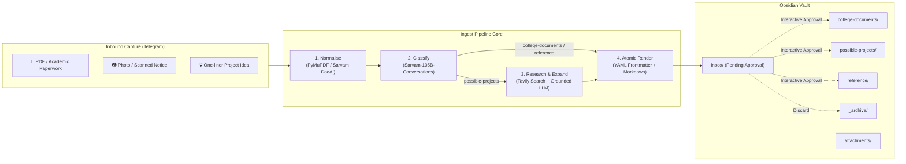

# Ingest

<div align="center">


**An intelligent, multi-modal ingestion pipeline that transforms inbound Telegram messages, scans, and ideas into a structured Obsidian knowledge base.**

[Key Features](#-key-features) • [Architecture](#-architecture) • [Getting Started](#-getting-started) • [Vault Hierarchy](#-vault-hierarchy) • [Testing](#-testing--verification)

</div>

---

## ⚡ Overview

**Ingest** bridges mobile communication and personal knowledge management. Content forwarded or sent to a private Telegram bot is extracted, classified, enriched with live web research, and atomically filed into your local [Obsidian](https://obsidian.md) vault with one-tap approval.

Built on **Hexagonal Architecture (Ports and Adapters)**, Ingest delegates all AI operations to [Sarvam AI](https://sarvam.ai) (Document Intelligence OCR, Sarvam LLM, Language Identification, and Translation) and live search grounding to Tavily/Brave.



---

## ✨ Key Features

- **⚡ Fast Acknowledgement (< 2s)**: Immediate receipt acknowledgement (`Reading…` / `Thinking…`) so the Telegram client feels instantaneous.
- **📄 Dual-Path Document Intelligence**:
  - *Digital PDF Fast-Path*: Text extracted locally via PyMuPDF in under 5ms without API consumption or latency.
  - *Sarvam DocAI Pipeline*: High-accuracy OCR parsing for scanned receipts, certificates, and multi-language document photos.
- **🔍 Grounded Project Research Briefs**: One-line project ideas are automatically researched against real-world web results. The bot generates a 5-section Markdown brief containing:
  - Description (scope and target audience)
  - Similar projects & competitors (with authentic web links)
  - Recommended research areas
  - Anticipated technical problems & mitigations
  - Open design questions
- **🏷️ Automated Metadata & Strict YAML Frontmatter**: Generates Obsidian-native frontmatter including titles, dates, source tags, document types, issuers, and reference IDs.
- **🛡️ Atomic File Operations**: Writes notes via temporary files and `os.replace` to guarantee zero partial or corrupted notes on crash.
- **🔘 Interactive Telegram Controls**:
  - **Approve**: Immediately files from `inbox/` to the classified folder.
  - **Change folder**: Select a different folder with automatic correction logging to `_corrections.jsonl`.
  - **Discard**: Moves note and its attachment cleanly to `_archive/`.

---

## 🏛️ Architecture & Design Principles

The project strictly follows the **Functional Core, Imperative Shell** methodology:

```
┌─────────────────────────────────────────────────────────────────┐
│                       bot.py (Telegram Shell)                   │
└───────────────────────────────┬─────────────────────────────────┘
                                │
┌───────────────────────────────▼─────────────────────────────────┐
│                     pipeline.py (Orchestrator)                  │
└───────┬─────────────────────────────────────────────────┬───────┘
        │                                                 │
┌───────▼──────────────────────┐   ┌──────────────────────▼───────┐
│     Pure Functional Core     │   │      Adapters (I/O Shell)    │
│  models.py · prompts.py      │   │  sarvam_llm · sarvam_ocr     │
│  render.py (Zero I/O)        │   │  sarvam_text · search · vault│
└──────────────────────────────┘   └──────────────────────────────┘
```

1. **Functional Core**: Prompt compilation (`prompts.py`) and note formatting (`render.py`) are pure, deterministic functions with zero I/O and zero async logic. They execute in microseconds and are testable without network or filesystem access.
2. **Ports and Adapters (`src/ingest/adapters/`)**: Concrete services implement narrow `typing.Protocol` interfaces (`LlmPort`, `OcrPort`, `TextPort`, `SearchPort`, `VaultPort`).
3. **No Grounding Hallucinations**: Search fallbacks never invent fake URLs or dummy competitor domains. If search encounters an error, failures are transparently surfaced as `IngestError("search")`.
4. **Collision Resilience**: Filename collisions in notes and attachments (e.g. `Marksheet-2.pdf`) are resolved atomically and synchronized with YAML frontmatter links.

---

## 🚀 Getting Started

### Prerequisites

- **Python**: `>= 3.12` (Python 3.12, 3.13, and 3.14 supported)
- **uv** (recommended) or standard `pip` / `venv`
- **Obsidian**: Local vault folder on your machine

### 1. Clone the Repository

```bash
git clone https://github.com/your-username/SarvamProject.git
cd SarvamProject
```

### 2. Environment Setup

#### Using `uv` (Recommended)

```bash
# Create and synchronize virtual environment
uv venv --python 3.12 .venv

# Windows PowerShell:
.\.venv\Scripts\Activate.ps1
# Linux / macOS:
source .venv/bin/activate

# Install dependencies in editable mode
uv pip install -e ".[dev]"
```

#### Using standard `pip`

```bash
python -m venv .venv

# Windows PowerShell:
.\.venv\Scripts\Activate.ps1
# Linux / macOS:
source .venv/bin/activate

python -m pip install --upgrade pip
pip install -e ".[dev]"
```

---

## ⚙️ Configuration

Create your `.env` configuration by copying `.env.example`:

```bash
cp .env.example .env
```

Open `.env` and configure your API keys and local paths:

```ini
# ==============================================================================
# Ingest Configuration (.env)
# ==============================================================================

# [REQUIRED] Sarvam AI API subscription key
# Sign up at: https://www.sarvam.ai/
SARVAM_API_KEY=sk_your_sarvam_api_key_here

# [REQUIRED] Telegram Bot Token from @BotFather
# Create a bot via https://t.me/BotFather to obtain token
TELEGRAM_BOT_TOKEN=123456789:ABCdefGhIJKlmNoPQRsTUVwxyZ

# [REQUIRED] Web Search Provider API Key (Tavily or Brave Search)
# Sign up at: https://tavily.com/
SEARCH_API_KEY=tvly-your_tavily_api_key_here

# [REQUIRED] Absolute filesystem path to your Obsidian vault root
# Windows example: D:\ObsidianVault
# Linux/macOS example: /home/username/vault
VAULT_PATH=D:\github_repos\CurrentProjects\SarvamProject\VAULT

# [OPTIONAL] Sarvam LLM Model (default: sarvam-105b-conversations)
MODEL=sarvam-105b-conversations

# [OPTIONAL] Translation Model
TRANSLATE_MODEL=sarvam-translate:v1

# [OPTIONAL] Maximum Attachment Download Limit (in MB)
MAX_DOWNLOAD_MB=20
```

> [!TIP]
> **Model Selection**: Use `sarvam-105b-conversations` for structured chat, JSON extraction, and Markdown briefs. The base `sarvam-105b` model uses chain-of-thought tokens that can exhaust completion limits on long briefs.

---

## 🏃 Running the Application

### 1. Start the Telegram Bot

Run the bot directly via the entrypoint script:

```bash
# Using uv:
uv run ingest

# Or directly with python:
python -m ingest.main
```

You should see startup logging in your console:
```text
2026-11-03 21:00:00 - ingest - INFO - Initializing vault at D:\github_repos\CurrentProjects\SarvamProject\VAULT
2026-11-03 21:00:00 - ingest - INFO - Initializing Telegram bot application...
2026-11-03 21:00:01 - ingest - INFO - Bot ready! Listening for messages...
```

### 2. Using the Bot

1. Open Telegram and search for your bot.
2. Send `/start` to verify connectivity.
3. Try sending:
   - **Academic PDF or Marks Notice**: Extracted, tagged, and proposed for `college-documents/`.
   - **One-liner Project Idea**: (e.g., *"Multi-Camera 3D Video Stream"*): Researched and structured into `possible-projects/`.
   - **General Reading / Screenshot**: Parsed and formatted into `reference/`.
4. Click **Approve** on the inline keyboard to immediately file it to your Obsidian vault.

---

## 📂 Vault Hierarchy

Ingest automatically organizes your local Obsidian vault following standard knowledge base taxonomy:

```
VAULT/
├── inbox/                        # Temporary staging area for pending proposals
├── college-documents/            # Academic paperwork, marks cards, letters
├── possible-projects/            # Grounded research briefs for project ideas
├── reference/                    # General notes, articles, study material
├── _archive/                     # Discarded notes and obsolete attachments
│   └── attachments/
├── attachments/                  # Binary files organised by category
│   ├── college-documents/
│   ├── possible-projects/
│   └── reference/
└── _corrections.jsonl            # Machine-readable user folder correction logs
```

### Note Frontmatter Specification

Every note is created with standardized YAML frontmatter compatible with Obsidian's Properties view:

```yaml
---
title: Engineering Physics Semester Marksheet
category: college-documents
created: 2026-11-03
source: telegram
status: filed
tags:
  - physics
  - marksheet
  - academics
document_type: Marksheet
issuer: Delhi Technological University
issued_date: 2026-06-15
reference_ids:
  - 2K22/CO/108
original_filename: Semester_VI_Marksheet.pdf
attachment: attachments/college-documents/Semester_VI_Marksheet.pdf
---

## Summary
Official university semester grade card reflecting performance in engineering physics...
```

---

## 🧪 Testing & Verification

The codebase includes an extensive suite of **229 tests** covering unit behavior, protocol adherence, adversarial edge cases, and end-to-end user journeys.

```bash
# Run unit & adapter tests (offline, fast, no network required):
pytest -p no:junitxml tests/test_adapters.py tests/test_pipeline.py tests/test_vault.py tests/test_bot.py tests/test_render.py tests/test_prompts.py

# Run adversarial tests (stress testing, bad inputs, Unicode boundaries):
pytest -p no:junitxml tests/test_adversarial_m1.py tests/test_adversarial_m2_m3.py tests/test_adversarial_m6.py

# Run full End-to-End (E2E) test harness:
python -m unittest discover -s tests/e2e
```

### Test Suite Structure

| Suite | Tests | Purpose |
|---|---|---|
| `test_render.py` | 11 | Golden-file verification, slugification, Unicode NFC sanitization |
| `test_prompts.py` | 8 | Strict JSON schema injection, prompt contracts, and search block formatting |
| `test_adapters.py` | 26 | Protocol conformance, DocAI polling, PyMuPDF fast path, FileVault atomicity |
| `test_pipeline.py` | 30 | Complete 6-stage lifecycle, attachment collision handling, repair retries |
| `test_bot.py` | 35 | Telegram handlers, size validations, inline keyboard routing, fast receipts |
| `test_adversarial_*.py` | 93 | Malformed payloads, token exhaustion boundaries, network disconnection recovery |
| `tests/e2e/` | 26 | Opaque-box scenario verification from inbound bytes to vault filesystem |

---

## 🛠️ Project Structure

```text
SarvamProject/
├── src/
│   └── ingest/
│       ├── __init__.py           # Package namespace
│       ├── main.py               # Application bootstrap & dependency injection
│       ├── config.py             # Pydantic Settings & environment validation
│       ├── models.py             # Typed domain entities (Capture, Classification, Note)
│       ├── prompts.py            # Pure prompt compilation engines
│       ├── render.py             # Pure note Markdown and YAML frontmatter renderer
│       ├── pipeline.py           # Ingestion orchestrator (Stage transitions)
│       ├── bot.py                # Telegram bot event handlers & keyboards
│       └── adapters/
│           ├── ports.py          # Abstract Protocol definitions
│           ├── sarvam_llm.py     # Sarvam AI chat & JSON completions adapter
│           ├── sarvam_ocr.py     # Sarvam DocAI & PyMuPDF OCR adapter
│           ├── sarvam_text.py    # Sarvam Language Identification & Translation
│           ├── search.py         # Tavily / Brave Search grounding adapter
│           └── vault.py          # Atomic Obsidian filesystem persistence
├── tests/
│   ├── fakes.py                  # In-memory test doubles (zero network)
│   ├── golden/                   # Baseline fixture notes for regression checks
│   ├── test_*.py                 # Unit & adversarial test modules
│   └── e2e/                      # Multi-tier end-to-end integration harness
├── .env.example                  # Environment configuration template
├── pyproject.toml                # Build system and dependency declarations
└── README.md                     # Technical documentation
```

---

## 📜 License

This project is licensed under the MIT License. See [LICENSE](LICENSE) for details.
